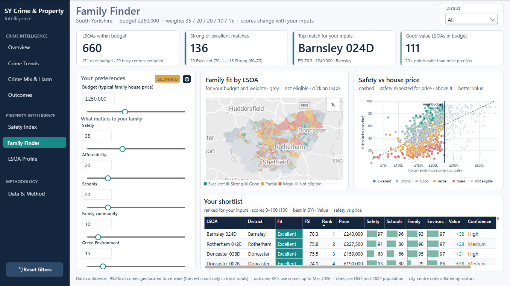

# South Yorkshire Crime & Property Intelligence

An end-to-end analytics project that combines **527,597 police.uk records** with ONS population, the English Indices of Deprivation 2025, Census 2021 and **47,943 HM Land Registry sales** across South Yorkshire's **860 LSOAs**, and turns them into an eight-page Power BI report with two composite indices:

- **Neighbourhood Safety Index (NSI):** a baseline, severity-weighted safety score for every LSOA.
- **Family Suitability Index (FSI):** a buyer-adjustable score combining safety, affordability against a budget, schools, family community and environment.

Write-up: [`Medium_Article_SY_Crime_Property_Intelligence`](https://medium.com/@aaadebawojo/is-it-safe-and-can-we-afford-it-562a0b202af3)



---

## Architecture

```
police.uk API ──┐
police.uk CSVs ─┤   Python loaders        PostgreSQL 18 (database: CrimeData)                         Power BI (Import)
ONS / IoD /     ├──────────────────▶  police · police_bulk · external_raw  ──▶  analytics  ──▶  pbi  ──▶  semantic model + 8-page report
Census / Land   │                     (raw, never modified)                    (staging, star       (thin       (DAX, Azure Maps,
Registry files ─┘                                                              schema, indices)      views)      Deneb / Vega-Lite)
```

| Layer | Purpose |
|---|---|
| `police` | police.uk API data as loaded (crimes, outcomes, locations, neighbourhood boundaries) |
| `police_bulk` | Bulk street-crime CSVs, stored verbatim with file and row number |
| `external_raw` | ONS population, IoD 2025, Census 2021, Land Registry Price Paid, ONS postcode lookup |
| `analytics` | Typed staging views, config tables, star schema (materialised views), NSI and FSI, data-quality views, refresh procedures |
| `pbi` | Thin views with only the columns the report needs; the only schema Power BI imports |

Key techniques: API polygon tiling and de-duplication; a coordinate crosswalk to assign crimes to LSOAs without PostGIS (99.9% of located crimes matched); ONS Crime Severity Score weights derived per police.uk category (reproduces the ONS published score for South Yorkshire, 20.57 vs 20.58); empirical Bayes smoothing; over-dispersion-corrected trend tests; percentile scoring; DAX what-if scenarios and live ranking.

## Repository structure

| Folder | Contents |
|---|---|
| `python/` | Loaders and preparation scripts (see *Reproduce* below) |
| `sql/` | PostgreSQL scripts, numbered in run order (00 = raw schema, 01–02 discovery and profiling, 03–13 build) |
| `powerbi/` | The `.pbix` report, the theme JSON and the 11 Deneb (Vega-Lite) specs |
| `data/reference/` | Derived crime severity weights |
| `data/boundaries/` | South Yorkshire LSOA boundaries (GeoJSON and TopoJSON) prepared for Azure Maps |
| `docs/` | Methodology and transformation log, data dictionary, design system, report build guide, loader setup, source ERD |
| `images/dashboard/` | Screenshots of all eight report pages |
| `article/` | The Medium article |

## The report

| # | Page | Question |
|---|---|---|
| 1 | Overview | How safe is South Yorkshire, where, and is it changing? |
| 2 | Crime Trends | Is crime rising or falling, and when does it peak? |
| 3 | Crime Mix & Harm | What kinds of crime happen, and which cause the most harm? |
| 4 | Outcomes | What happens after a crime is reported? |
| 5 | Safety Index | Which neighbourhoods are safest, and how robust is the ranking? |
| 6 | Family Finder | Where should a family with my budget and priorities look? |
| 7 | LSOA Profile & Compare | What is this neighbourhood like, and how does it compare? |
| 8 | Data & Method | Where do the numbers come from, and how far can I trust them? |

Screenshots: [`images/dashboard/`](images/dashboard/).

## Reproduce

Requirements: PostgreSQL 16+ (built on 18.6), Python 3.10+, Power BI Desktop (Deneb custom visual from AppSource; Azure Maps enabled).

```bash
pip install -r requirements.txt
set PGPASSWORD=...                     # or $env:PGPASSWORD in PowerShell; never commit it

# 1. police.uk API (creates database CrimeData and schema police; 1–3 hours)
python python/load_crime_data.py

# 2. police.uk bulk CSVs (custom download, South Yorkshire street crime, Oct 2023 – Sep 2026)
python python/load_bulk_csv.py --folder <police_csv folder> --recursive

# 3. External data (ONS population, IoD 2025, Census 2021 TS003/TS054)
python python/load_external_data.py --folder <external_data folder>

# 4. Land Registry Price Paid + ONS postcode lookup
python python/load_house_prices.py --folder <external_data folder>

# 5. Severity weights (ONS CSS xls + Home Office PFA ods + police.uk category mapping)
python python/derive_severity_weights.py --folder <external_data folder>

# 6. Run sql/03 … sql/13 in order (e.g. in DBeaver). sql/01–02 are read-only discovery queries.

# 7. LSOA boundaries for Azure Maps (ONS LSOA Dec 2021 BGC GeoJSON)
python python/prepare_lsoa_boundaries.py --input <LSOA 2021 BGC geojson> --outdir data/boundaries
```

Then open `powerbi/SY_Crime_Property_Intelligence.pbix`, point the PostgreSQL connection at your server and refresh. See `docs/Report_Build_Guide.md` for every visual, field and setting.

**Raw data is not included** (about 1.2 GB, all freely downloadable; see *Data sources*). The `.pbix` contains the imported model.

## Data sources and licences

| Source | Licence |
|---|---|
| police.uk street-level crime, ASB and outcomes (South Yorkshire Police) | Open Government Licence v3.0 |
| ONS mid-year population estimates by LSOA (mid-2022 to mid-2024) | OGL v3.0 |
| English Indices of Deprivation 2025 (MHCLG) | OGL v3.0 |
| Census 2021 TS003 and TS054 (ONS / Nomis) | OGL v3.0 |
| HM Land Registry Price Paid Data | OGL v3.0. Contains HM Land Registry data © Crown copyright and database right. |
| ONS Postcode to OA/LSOA/MSOA/LAD lookup | OGL v3.0 |
| ONS Crime Severity Score; Home Office police recorded crime by PFA | OGL v3.0 |
| ONS LSOA (Dec 2021) BGC boundaries | OGL v3.0. Contains OS data © Crown copyright and database right. |

## Limitations

Locations are anonymised and 4.8% of crimes have none; recorded crime is not all crime; resident-based rates overstate risk in busy centres (29 are flagged); scores are relative to South Yorkshire; house prices are medians of recent sales, not valuations; outcomes lag, so outcome KPIs use crimes at least six months old; the schools component is an area indicator, not school results. Full register: `docs/Methodology_and_Transformation_Log.md`.

## Acknowledgements

Built with an AI assistant (Claude) as a collaborator for drafting SQL, DAX, chart specifications and documentation. All design decisions, data validation and the report build were carried out and checked by the author.
